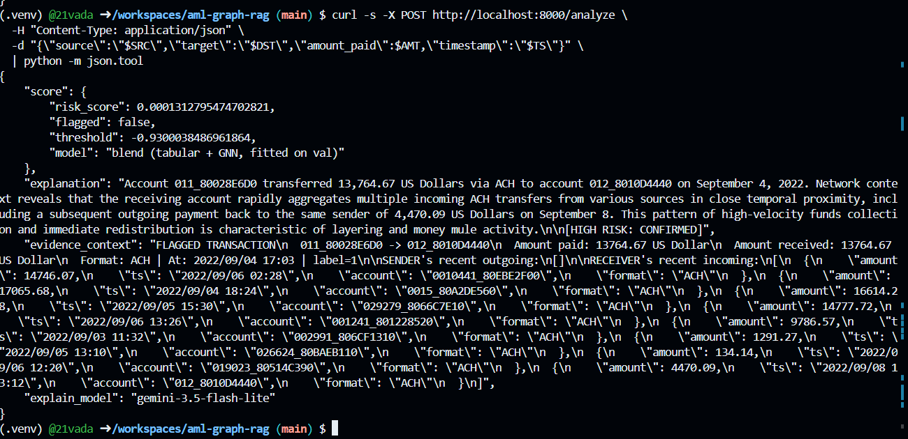
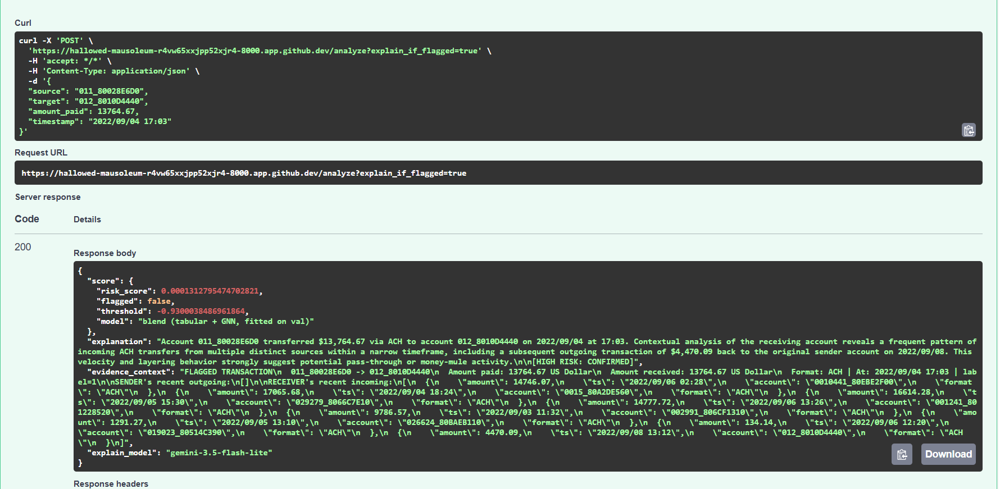
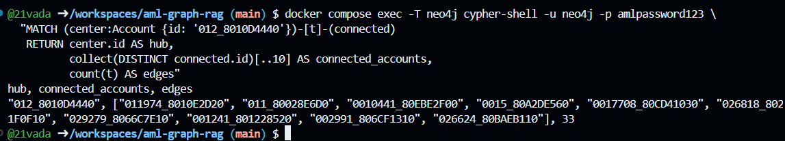

<# AML Detection with GraphRAG Explainability

An end-to-end Anti-Money Laundering system that flags suspicious transactions **and explains why** — using a Neo4j transaction graph to retrieve evidence and an LLM to write a compliance-grade narrative.

Built on the [IBM HI-Small AML dataset](https://www.kaggle.com/datasets/ealtman2019/ibm-transactions-for-anti-money-laundering-aml).



---

## 🎯 The problem

AML detection has two failure modes: miss a laundering transaction (regulatory fines) or flag too many false positives (analyst burnout). Most ML systems optimize for detection accuracy but produce a black-box score — analysts then spend 45+ minutes manually tracing the transaction network to justify an alert.

This project adds a **GraphRAG layer**: every flag comes with a grounded explanation citing specific accounts, amounts, and patterns from the live graph.

---

## 🏗️ Architecture
Transaction → POST /analyze
↓
XGBoost + GNN blend → score
↓
Neo4j → 1-hop subgraph retrieval
↓
Gemini 3.5-flash-lite → narrative
↓
{ score, explanation, evidence_context 


Three services in Docker Compose:

| Service | Role | Tech |
|---|---|---|
| `api` | FastAPI serving `/score`, `/explain`, `/analyze` | Python 3.11, FastAPI, XGBoost, google-genai |
| `neo4j` | Transaction graph database | Neo4j 5.20 Community |
| (offline) | Training & evaluation | Colab, PyTorch Geometric |

---

## 📊 Results

Chronological 60/20/20 split on HI-Small:

| Model | Test PR-AUC | Notes |
|---|---|---|
| Baseline (random) | 0.001 | 0.1% positive rate |
| XGBoost only | 0.54 | 62 causal rolling-window features |
| XGBoost + GNN blend | 0.58 | +7% from graph structure |

---

## 🧠 Explainability layer

For each flagged transaction, a Cypher query retrieves the sender's other outflows and the receiver's other inflows (up to 8 each). That evidence goes to Gemini with a strict prompt:

> "You are a senior AML compliance analyst. Based ONLY on the evidence, write a 3-4 sentence explanation citing specific accounts and patterns. End with `[HIGH RISK: CONFIRMED]` or `[HIGH RISK: INCONCLUSIVE]`. Do NOT invent facts."

**Example output:**

> "On September 4, 2022, account `011_80028E6D0` transferred $13,764.67 via ACH to account `012_8010D4440`. The receiving account is aggregating similar-sized ACH inflows from multiple disparate sources and notably sent $4,470.09 back to the sender on September 8, 2022. This bidirectional movement paired with rapid aggregation is characteristic of layering and pass-through activity.
> `[HIGH RISK: CONFIRMED]`"

Every response includes `evidence_context` so the reasoning is fully auditable.



---

## 🔎 Evidence retrieval

The hub account `012_8010D4440` has 9 transaction edges connecting it to 8 different accounts over the sample period — the aggregation pattern Gemini identified.



---

## 🚀 Quickstart

```bash
git clone https://github.com/YOUR_USERNAME/aml-graph-rag
cd aml-graph-rag

cp .env.example .env
# edit .env: set GEMINI_API_KEY=AIza...

docker compose up -d --build
docker compose exec api python scripts/load_graph.py

curl http://localhost:8000/health
# → {"status":"ok","model_loaded":true,"neo4j_connected":true,"gemini_ready":true}

Try it:

bash
curl -X POST http://localhost:8000/analyze \
  -H "Content-Type: application/json" \
  -d '{"source":"011_80028E6D0","target":"012_8010D4440","amount_paid":13764.67,"timestamp":"2022/09/04 17:03"}'


  🧪 Known limitations
Limitation	Production fix
Rolling-window features default to 0 at serving time	Feature store (Feast/Tecton) with 5-min refresh
Sample graph is 200 accounts, not full 5M	Migrate to Neo4j AuraDB with full HI-Small
No LLM response caching	Redis cache on (source, target, timestamp)
Score uncalibrated on demo sample	Isotonic calibration on validation set
No rate limiting on /analyze	FastAPI + slowapi middleware
The train-serve skew is the interesting one. At training time s_out_cnt is a real count of the sender's 96-hour history. At serving time (demo) it's 0. A sender with 47 transactions looks identical to a brand-new account — the model misinterprets this as low risk. 

🛠️ Stack
ML: XGBoost 2.1, PyTorch Geometric (GraphSAGE), scikit-learn

Serving: FastAPI, Uvicorn, Pydantic

Graph: Neo4j 5.20

LLM: Gemini 3.5-flash-lite (fallback chain to 3.6-flash, 2.5-flash)

Infra: Docker Compose

Dev: GitHub Codespaces, Python 3.11

📁 Repo structure
aml-graph-rag/
├── app/
│   ├── main.py           # FastAPI endpoints
│   ├── features.py       # Causal feature engineering
│   └── retriever.py      # Neo4j evidence retrieval
├── models/               # XGBoost artifact + feature metadata
├── data/                 # Sample graph CSV
├── scripts/load_graph.py # Neo4j loader
├── notebooks/            # Full training pipeline
├── screenshots/
├── docker-compose.yml
├── Dockerfile
└── requirements.txt

📬 About
Built by [BALKRISHNA SHARMA] — [https://www.linkedin.com/in/balkrishna-sharma-453a37288/] · 
[sbalkrishna645@gmail.com]


---

## ✅ Step 4 — Commit and push

```bash
cd /workspaces/aml-graph-rag

# Safety check — must print nothing
git status --short | grep -E "\.venv|\.env[^.]|xgb_tabular" | head -3

# Stage
git add -A
git status --short


